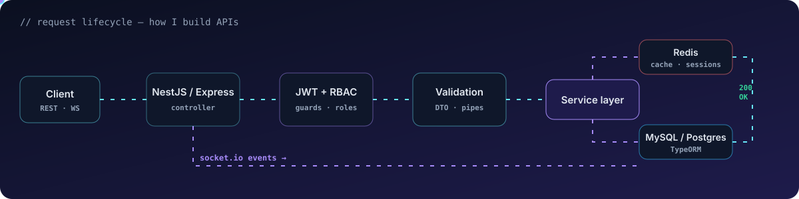
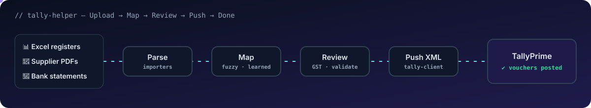

<div align="center">


<br/><br/>

<a href="https://github.com/aamer444"></a>
<a href="https://www.linkedin.com/"></a>
<a href="https://github.com/aamer444?tab=followers"></a>
<a href="https://github.com/aamer444"></a>

</div>

<br/>

## 🪐 About

<table>
<tr>
<td valign="top" width="55%">

**Backend Engineer** with **5+ years** building production systems in **Node.js and TypeScript**. I design REST and real-time APIs, authentication and **role-based access control**, microservices and third-party integrations — with clean data models on **MySQL, PostgreSQL, MongoDB and Redis**.

I care about the boring parts that keep systems alive: input validation, guards, caching, error handling and docs that a new teammate can actually follow. Lately I've also been shipping **desktop and web front-ends** (Tauri, React) when a product needs the whole slice, not just the API.

I build with **AI-assisted workflows** — Claude Code, Codex, Copilot, Cursor — to move faster without lowering the bar on reviews and tests.


</td>
<td valign="top" width="45%">

```ts
const aamer = {
  role:       "Backend Engineer",
  experience: "5+ years",
  location:   "Mumbai, India",
  core:       ["Node.js", "TypeScript", "NestJS", "Express"],
  data:       ["MySQL", "PostgreSQL", "MongoDB", "Redis"],
  strengths:  ["REST & WebSocket APIs", "Auth & RBAC",
               "Microservices", "3rd-party integrations"],
  also:       ["React", "Tauri", "Docker", "AWS"],
  aiTools:    ["Claude Code", "Codex", "Copilot", "Cursor"],
  learning:   "Java + DSA",
};
```

</td>
</tr>
</table>

> [!TIP]
> **Ship small, ship safe.** Typed DTOs, guarded routes, cached reads and a Swagger page on every service — so the API explains itself before anyone asks.

<br/>

## 📊 At a Glance

<div align="center">


</div>

<br/>


## 🧩 What I Do

<table>
<tr>
<td valign="top" width="33%">

### ⚙️ API Engineering
Fast, documented, versioned APIs.

- REST &amp; WebSocket (Socket.io)
- NestJS modules &amp; Express
- DTO validation &amp; pipes
- Swagger / OpenAPI docs

</td>
<td valign="top" width="33%">

### 🔐 Auth &amp; Access
Security as a default, not a patch.

- JWT + Passport strategies
- Role / permission (RBAC) guards
- Redis-backed sessions
- bcrypt &amp; least privilege

</td>
<td valign="top" width="34%">

### 🔄 Data &amp; Integrations
Moving data between real systems.

- TypeORM on MySQL / Postgres
- Caching with Redis
- OCR &amp; document pipelines
- Accounting (TallyPrime) XML sync

</td>
</tr>
</table>

<br/>

## 🛰️ How I Build APIs



<details>
<summary><b>Layer by layer</b></summary>

<br/>

| Layer | What I put there |
|---|---|
| **Controller** | Thin routes, versioned paths, Swagger decorators so docs never drift |
| **Guards** | JWT auth, role and permission checks, rate limits on sensitive routes |
| **Validation** | `class-validator` DTOs and pipes — bad input never reaches the service |
| **Service** | Business rules, transactions, idempotent writes, clear domain errors |
| **Cache** | Redis for sessions, hot reads and short-lived tokens |
| **Persistence** | TypeORM entities and migrations on MySQL / PostgreSQL, indexes on real query paths |
| **Real-time** | Socket.io gateways for live dashboards and notifications |

</details>

<br/>


## 🚀 Featured Projects

<table>
<tr>
<td valign="top" width="50%">

### 🧾 [tally-helper](https://github.com/aamer444/tally-helper)
Desktop app that turns **Excel registers, supplier PDF bills and bank statements** into reviewed **TallyPrime vouchers** — replacing a mix of paid tools with one flow.

`Tauri 2` `React` `TypeScript` `SQLite` `pnpm monorepo` `Rust`

</td>
<td valign="top" width="50%">

### 🔐 [rbac_backend](https://github.com/aamer444/rbac_backend)
Role-based access control platform: users, roles, permissions, sessions and a dashboard API with live updates.

`NestJS 11` `JWT` `Passport` `TypeORM` `MySQL` `Redis` `Socket.io` `Swagger`

</td>
</tr>
<tr>
<td valign="top" width="50%">

### 🏭 [esper_home](https://github.com/aamer444/esper_home)
Marketing site for **Esper Radiators &amp; Products** — product catalogue, SEO, scroll animations and enquiry forms.

`React 19` `TypeScript` `Vite` `Tailwind CSS 4` `React Hook Form`

</td>
<td valign="top" width="50%">

### 📄 [TEST_DLP](https://github.com/aamer444/TEST_DLP)
OCR document-processing API — accepts uploads or base64 images/PDFs, validates type and size, extracts data with Redis-backed caching.

`Node.js` `Express` `OCR` `Redis`

</td>
</tr>
</table>

<details>
<summary><b>🧾 Inside tally-helper</b></summary>

<br/>



| Package | Responsibility |
|---|---|
| `packages/importers` | Excel / CSV / bank PDF / GSTR-2B parsing |
| `packages/mapping-engine` | Rules, learned mappings, fuzzy ledger matching |
| `packages/domain` | Canonical models, GST and money handling |
| `packages/tally-client` | XML builders, transport and response parser |
| `packages/sync` | AlterID-based incremental mirror of Tally |
| `packages/storage` | SQLite schema, migrations, repositories |
| `tools/tally-mock` | Fake Tally server on `:9900` for tests |

</details>

<br/>

## 🛠️ Technology Stack

<div align="center">


<br/>

<br/>


</div>

<br/>

<table>
<tr>
<td valign="top" width="50%">

**⚙️ Backend**


-0f172a?style=flat-square&logo=openjdk&logoColor=67e8f9&labelColor=1e1b4b)

**🗄️ Data**


</td>
<td valign="top" width="50%">

**🎨 Frontend &amp; Desktop**


**☁️ Cloud &amp; DevOps**


**🤖 AI-Assisted Dev**


</td>
</tr>
</table>

<br/>


## 📈 GitHub Activity

<div align="center">


<br/><br/>


<br/><br/>

<picture>
  <source media="(prefers-color-scheme: dark)" srcset="https://raw.githubusercontent.com/aamer444/aamer444/output/github-snake-dark.svg" />
  <source media="(prefers-color-scheme: light)" srcset="https://raw.githubusercontent.com/aamer444/aamer444/output/github-snake.svg" />
  
</picture>

</div>

<br/>

## 🎯 Current Focus

- 🔐 Hardening **rbac_backend** — fine-grained permissions, session revocation and audit logs
- 🧾 Shipping **tally-helper** modules — bank statement auto-classification and credit/debit notes
- ☕ Leveling up in **Java** and **data structures &amp; algorithms**
- 🤖 Building faster with **AI-assisted engineering** while keeping tests and reviews strict

<details>
<summary><b>🧭 How I work</b></summary>

<br/>

| Principle | In practice |
|---|---|
| **Validate at the edge** | Every request goes through a DTO before it touches business logic |
| **Least privilege** | Roles and permissions are explicit; nothing is open by default |
| **Cache what's hot** | Redis in front of repeated reads, with clear invalidation |
| **Docs are part of the API** | Swagger on every service, READMEs that actually run |
| **Typed end to end** | TypeScript from DB entity to API response |
| **Small PRs, reviewed** | AI speeds up the draft; humans and tests approve the merge |

</details>

<br/>

<div align="center">


<br/><br/>

<a href="https://www.linkedin.com/"></a>
<a href="https://github.com/aamer444"></a>

<br/>

<sub>⚡ Build. Learn. Improve. Repeat. · Contribution snake refreshed by GitHub Actions.</sub>

</div>
